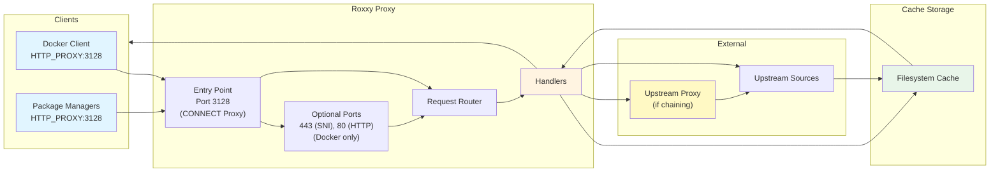
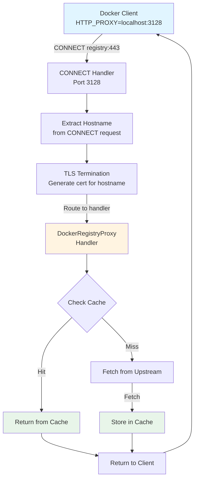
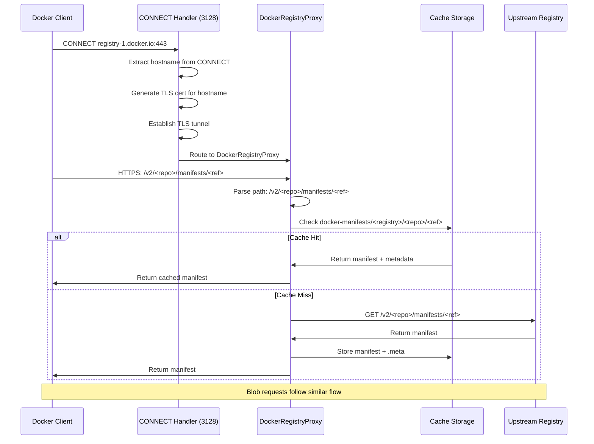
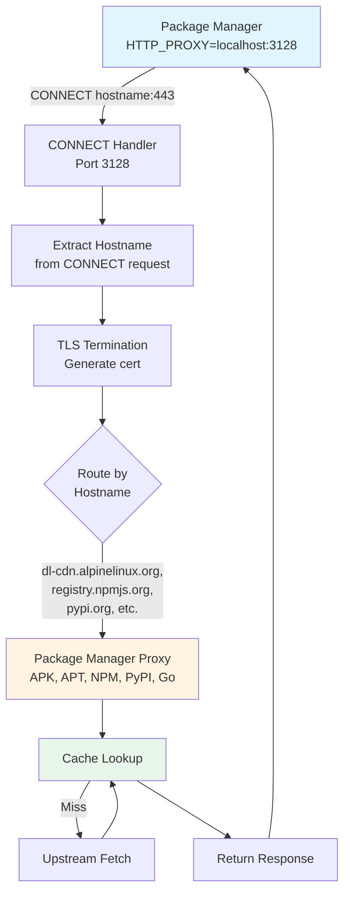
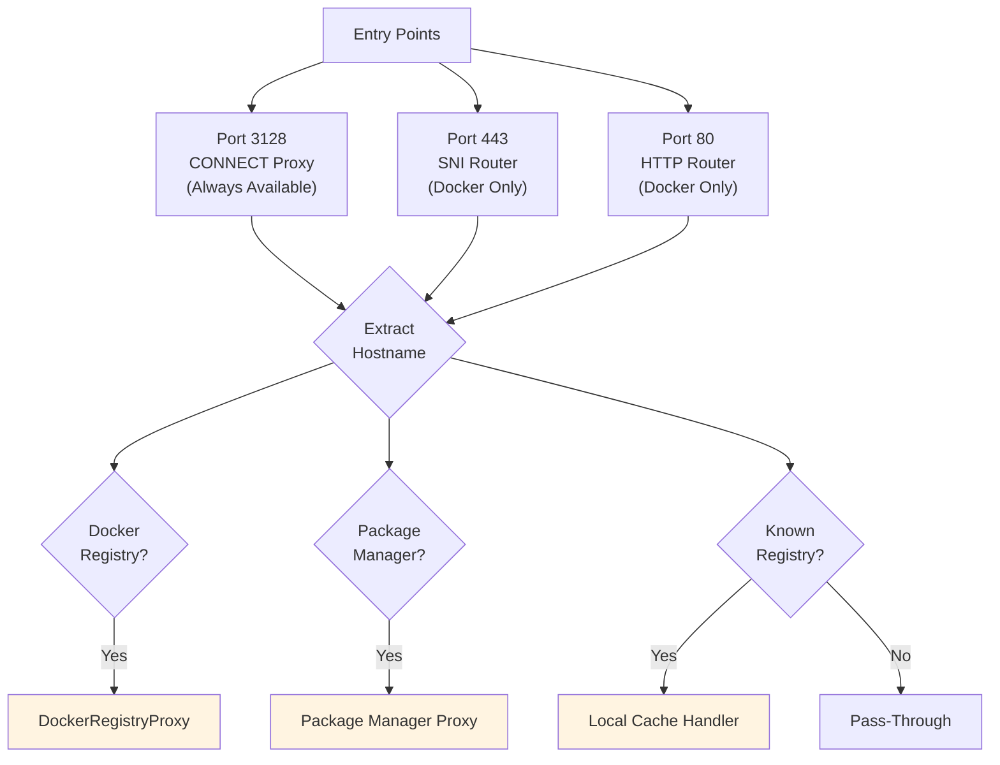
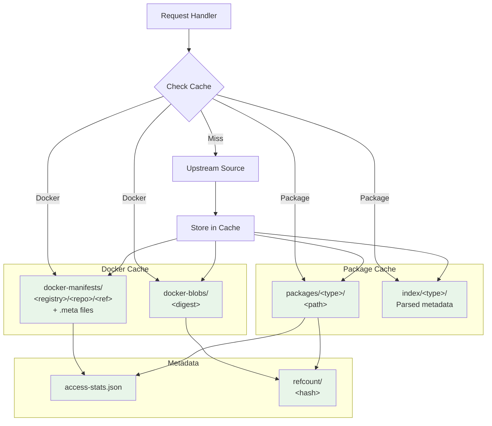
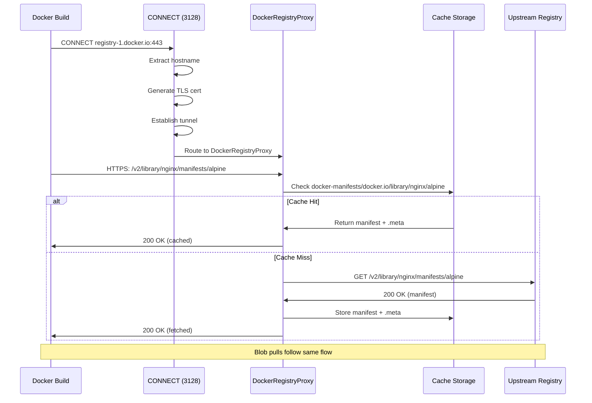
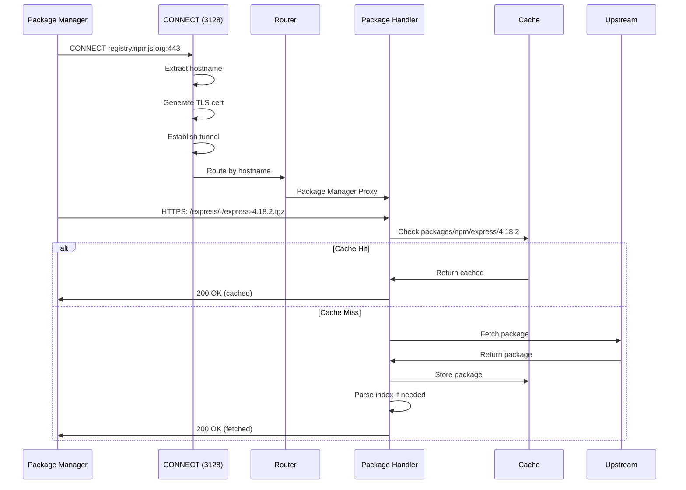

# Roxxy Data Flow Diagram

This diagram shows how data flows into and out of roxxy, including Docker client configuration via HTTP_PROXY, docker build integration, and cache storage.

## High-Level Overview



**See detailed flows below:**
- [Docker Client Flow](#docker-client-flow) → [Request Routing](#request-routing) → [Cache Storage](#cache-storage)
- [Package Manager Flow](#package-manager-flow) → [Request Routing](#request-routing) → [Cache Storage](#cache-storage)

## Docker Client Flow

Docker clients (including `docker build`, `docker pull`, etc.) connect via HTTP_PROXY on port 3128.



**Connects to:** [Request Routing](#request-routing) | [Cache Storage](#cache-storage)



**Note:** Ports 443 (SNI router) and 80 (HTTP router) are optional and only available when running in Docker containers. When running on the host, only port 3128 is used.

## Package Manager Flow

Package managers (APT, APK, NPM, PyPI, Go) connect via HTTP_PROXY on port 3128.



**Connects to:** [Request Routing](#request-routing) | [Cache Storage](#cache-storage)

## Request Routing



**Connects from:** [Docker Client Flow](#docker-client-flow) | [Package Manager Flow](#package-manager-flow)  
**Connects to:** [Cache Storage](#cache-storage)

## Cache Storage



**Connects from:** [Request Routing](#request-routing)  
**See:** [Cache Storage Structure](#cache-storage-structure) | [What Gets Stored](#what-gets-stored)

## Cache Storage Structure

### Docker Registry Cache

```
/app/cache/
├── docker-manifests/
│   └── <registry>/          # e.g., docker.io, quay.io
│       └── <repo>/           # e.g., library/golang → library_golang
│           ├── <tag>         # e.g., 1.25-alpine
│           ├── <tag>.meta      # Metadata (content_type, stored_at, upstream_url)
│           ├── sha256:<digest> # Manifest by digest
│           └── sha256:<digest>.meta
├── docker-blobs/
│   └── sha256:<digest>       # Blob content (layer data)
└── refcount/
    └── <hash>/               # Content hash (first 2 chars)
        └── <hash>/           # Next 2 chars
            └── <hash>         # Full hash (refcount file)
```

### Package Manager Cache

```
/app/cache/
├── packages/
│   ├── apk/                  # Alpine APK packages
│   ├── apt/                  # Debian/Ubuntu APT packages
│   ├── npm/                  # NPM packages
│   ├── pypi/                 # PyPI packages
│   └── go/                   # Go modules
├── index/                    # Parsed index database
│   └── <type>/               # Index files parsed by type
└── access-stats.json         # Access statistics
```

## Detailed Request Sequence

### Docker Build Request Flow



### Package Manager Request Flow



## What Gets Stored

### Docker Registry

1. **Manifests** (`docker-manifests/<registry>/<repo>/<reference>`)
   - Tag-based manifests (e.g., `library/golang:1.25-alpine`)
   - Digest-based manifests (e.g., `sha256:abc123...`)
   - Multi-platform indexes
   - Metadata files (`.meta`) containing:
     - Content type
     - Storage timestamp
     - Upstream URL

2. **Blobs** (`docker-blobs/<digest>`)
   - Layer data (tar.gz files)
   - Config blobs
   - Content-addressable storage
   - Refcount tracking for deduplication

### Package Managers

1. **Package Files** (`packages/<type>/<path>`)
   - APK: `.apk` files and `APKINDEX.tar.gz`
   - APT: `.deb` files and index files (`Packages.gz`, `Release`, etc.)
   - NPM: `.tgz` tarballs and registry JSON
   - PyPI: `.whl`, `.tar.gz` files and simple HTML pages
   - Go: `.zip` files, `.mod` files, and `.info` files

2. **Index Database** (`index/<type>/`)
   - Parsed metadata from index files
   - Package listings and dependencies
   - Used for package discovery and listing

3. **Access Statistics** (`access-stats.json`)
   - Access counts per cached item
   - Last access timestamps
   - Used for cache management and reporting

## Configuration

### Docker Client Configuration

**Docker Desktop (macOS/Windows):**
- Settings → Resources → Proxies
- HTTP Proxy: `http://host.docker.internal:3128`
- HTTPS Proxy: `http://host.docker.internal:3128`

**Docker Daemon (Linux):**
- `/etc/docker/daemon.json`:
  ```json
  {
    "proxies": {
      "http-proxy": "http://localhost:3128",
      "https-proxy": "http://localhost:3128"
    }
  }
  ```

### Roxxy Configuration

- **Config file**: `~/.roxxy/config.yaml` (or `./config.yaml`)
- **Cache directory**: `~/.cache/roxxy/` (Linux) or `~/Library/Application Support/roxxy/Cache/` (macOS)
- **Certificates**: `~/.roxxy/certs/`

### Proxy Chaining

Roxxy supports upstream proxy chaining:
```yaml
global:
  upstream_proxy: "http://upstream-proxy:3128"
```

This allows chaining: `airgap-roxxy → system-roxxy → internet`

## Key Features

1. **Transparent Proxying**: Clients don't need to know about cache structure
2. **Content-Addressable Storage**: Blobs stored by digest for deduplication
3. **Registry Isolation**: Manifests organized by registry to prevent collisions
4. **Index Parsing**: Package index files parsed for better cache management
5. **Access Tracking**: Statistics tracked for cache optimization
6. **Refcount Management**: Blobs tracked with reference counts for safe deletion

